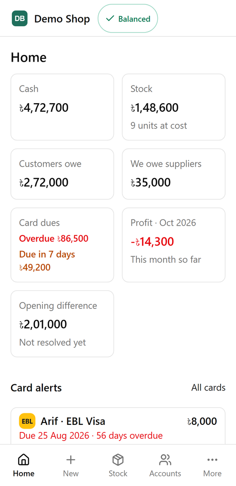
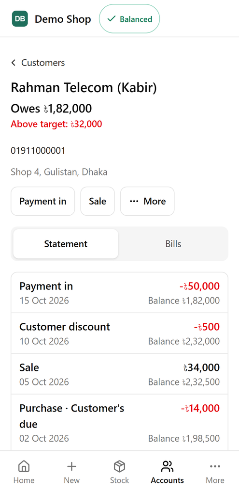
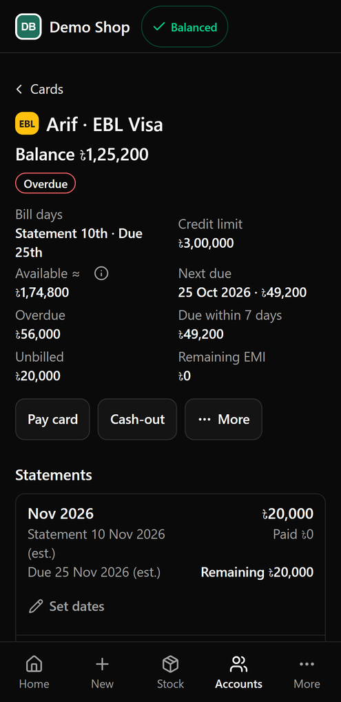
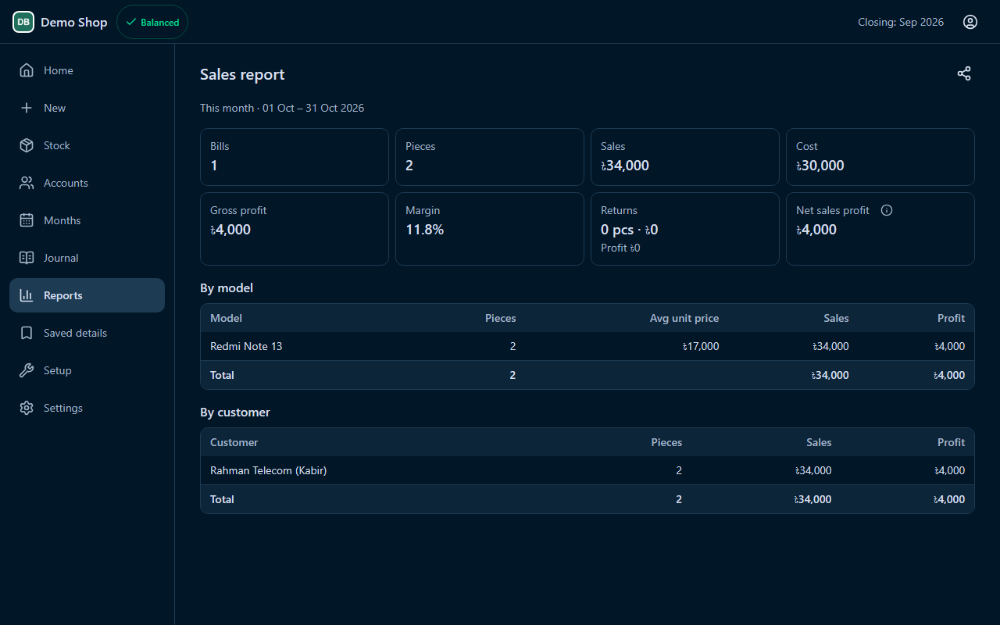
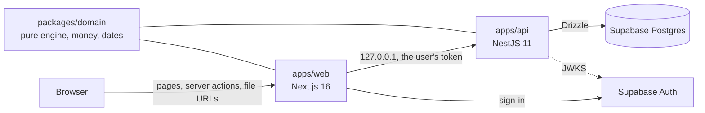

# Self-Balancing Bookkeeper

An exact bookkeeping system for a two-partner mobile-phone trading business in Bangladesh, in
daily use: a Next.js front end over a NestJS API, with every balance derived, never stored. It
replaced their Excel workbooks: purchases, sales, returns, card bills, customer and supplier dues,
stock, month close and profit sharing, all in BDT ৳ on the Asia/Dhaka calendar. It is built for a
phone first.

Every name, number and card in this repo is fictional (D-069). The project started in 2025; this
repository is the cleaned public version, prepared in October 2026.

| Home (phone) | A customer (phone) | A card (phone) |
|---|---|---|
|  |  |  |



## What makes it interesting

- **No stored balances.** Only facts are stored. Every balance (cash, stock, dues, card bills,
  profit) is derived on each request by one pure engine, and every test scenario checks that the
  books balance.
- **Money is never a float.** Amounts are integer poisha in TypeScript and `numeric(14,2)` in
  Postgres. Rounding is half-up, and only inside a few named functions.
- **Two apps with a hard boundary.** Next.js renders the UI and forwards every read, write and
  file to a NestJS api on `127.0.0.1`. Web has no database URL and no crypto key, and a lint rule
  keeps it that way.
- **Migrated without changing behaviour.** The app began as one Next.js monolith. A parity
  harness compared every page's text (at 360 and 1280 px), every PDF and Excel file, and the audit
  trail of a scripted write sequence against the old build, at the end of every migration session.
- **Card numbers are encrypted** (AES-256-GCM, bound to the card) and shown only after a
  fingerprint (WebAuthn passkey), never a password.

## Architecture



[`docs/ARCHITECTURE.md`](docs/ARCHITECTURE.md) walks through a read, a write and a file download.

| Part | Stack |
|---|---|
| UI | Next.js 16 (App Router, React Server Components, server actions), Tailwind, shadcn/ui, React Hook Form + Zod, Recharts |
| API | NestJS 11, Drizzle ORM, ExcelJS, `@react-pdf/renderer`, SimpleWebAuthn, jose |
| Data | Supabase Postgres + Auth (RLS on, no policies: only the api's connection reads) |
| Tests | Vitest, supertest, Playwright, axe |

## Run it locally

You need Node 24, npm and Docker (for local Supabase).

```bash
git clone <this repo> && cd Mobile-Business-Lite-Public
npm ci
npx supabase start                  # local Postgres + Auth in Docker (db 55322, api 55321)
npx supabase status -o env          # prints ANON_KEY for the next step
cp .env.example .env.local          # then fill in the two <ANON_KEY> lines and CARD_SECRET_KEY
npm run seed:demo                   # migrates, then loads the fictional demo book
npm run dev                         # web on http://localhost:3000, api on 127.0.0.1:3003
```

Sign in as `partner@test.local` with the password `partner-test-password`. `seed:demo` replaces
every row in the local database, and it only ever talks to local Supabase.

For `CARD_SECRET_KEY`, the test key is fine locally:
`node -e "console.log(Buffer.alloc(32, 7).toString('base64'))"`.

## Tests

| Command | What runs |
|---|---|
| `npm test` | unit: money, dates, every posting rule, the user stories, a hand-checked card fixture, PDF and sheet text, the boundary lint |
| `npm run test:int` | integration: the api in-process with real Supabase tokens, against local Supabase (writes, guards, month locks, audit rows, every `/views/*` and `/files/*` route, the token and role matrix) |
| `npm run test:e2e` | end to end: Playwright on both built apps, at 360 and 1280 px, in all 3 themes |
| `npm run typecheck && npm run lint` | TypeScript and ESLint, including a 1000-line cap per file |

At the end of the migration (October 2026) that was 723 unit tests, 215 integration tests in 42
files, and 287 end-to-end tests per theme. CI runs all of them on every push to `dev`, with the
E2E in 3 shards.

## Key decisions

The full log is [`docs/DECISIONS.md`](docs/DECISIONS.md). A few that shaped the code:

- **D-068:** NestJS owns the data, rules, crypto and files; Next.js stays the UI as a
  backend-for-frontend over an internal api.
- **D-069:** this public copy uses fictional data only; a denylist check and gitleaks keep real
  names out.
- **D-046, D-052, D-054:** saved card numbers are encrypted and revealed only after a fingerprint,
  with a 30-second window.
- **D-041:** PDFs are rendered on the server with embedded Noto fonts, so ৳ prints everywhere.
- **D-064:** charts are pure series over the engine's effects; only the chart pages load Recharts.
- **D-065:** each change runs its own tests locally; CI runs the full suites.

## Docs

[`docs/PRD.md`](docs/PRD.md) (what and why) · [`docs/SRS.md`](docs/SRS.md) (data model,
posting rules) · [`docs/UIDD.md`](docs/UIDD.md) (screens) ·
[`docs/ARCHITECTURE.md`](docs/ARCHITECTURE.md) · [`docs/TASKS-NEST.md`](docs/TASKS-NEST.md)
(the migration, step by step).

## License

MIT, see [`LICENSE`](LICENSE).
