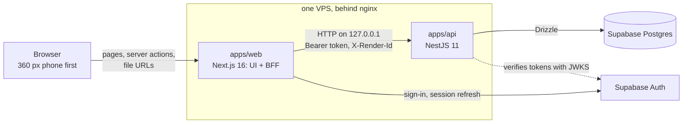

# Mobile Business Lite — Architecture

*28 October 2026 · after the NestJS migration (D-068)* — how the code is laid out and how a
request moves through it. The rules themselves are in `docs/SRS.md`; why each one changed is in
`docs/DECISIONS.md`.

## 1. The shape

- **Next.js is the UI and a backend-for-frontend.** It renders the same screens, URLs, cookies and
  messages as before the migration. It has no database URL and no card key; it calls the api from
  its server only.
- **Nest owns everything else:** the data, the posting rules' callers, the writes, the crypto, and
  the files (PDF, Excel, the export, the card reveal, the logo). It listens on `127.0.0.1` only;
  nginx never routes to it.
- **Facts are stored, balances derived.** No table holds a balance. Every figure comes from the
  pure engine, `computeBooks(data, asOf)` in `packages/domain/src/engine`, on each request.

## 2. Packages and their boundaries

| Package | Holds | May import |
|---|---|---|
| `packages/domain` (`@mbl/domain`) | the engine and posting rules (SRS §5), money (integer poisha), Dhaka dates, guards, Zod schemas, view helpers, labels, the Excel sheet builders | zod only: no React, Next, Nest, api or database |
| `packages/db` (`@mbl/db`) | the Drizzle schema, the SQL migrations, the client factory | domain |
| `apps/api` (`@mbl/api`) | one Nest service per area (books, journal, setup, sale, …), the write runner, the `/views/*` read endpoints, the `/files/*` routes, `pdf/` (react-pdf documents and fonts) | domain, db |
| `apps/web` (`@mbl/web`) | pages, components, `proxy.ts`, sign-in and sign-out, thin server actions, `src/api/` (the client, the file forwarder, the wire types) | domain; the api's **types only** |

The boundaries are lint rules (`eslint.config.mjs`, tested in `tests/engine/boundary-lint.test.ts`):
web can't import `@mbl/db`, `drizzle-orm`, `postgres`, `node:crypto`, `exceljs`, `@react-pdf/*` or
`@simplewebauthn/server`, and imports from the api must be `import type`.

## 3. A read: one page, one view

1. The browser asks for a page, for example `/customers/<id>`. `proxy.ts` refreshes the Supabase
   session cookie, or sends a signed-out browser to `/login`.
2. The page calls `api<View>("/views/customers/<id>?…")` (`apps/web/src/api/client.ts`). It sends:
   - the session's access token as `Authorization: Bearer …`;
   - the browser's `X-Forwarded-Host`/`-Proto` and `User-Agent`;
   - one random `X-Render-Id` per page render.
3. In Nest, the global `JwtGuard` verifies the token locally (the project's JWKS, or the legacy
   HS256 secret) and puts the user in the request context (AsyncLocalStorage, `auth/context.ts`).
4. The `/views/*` handler returns what the page used to compute from its loaders, trimmed to what
   the JSX needs. The **render memo** (`auth/memo.ts`) shares each loaded value, such as the books,
   across the calls of one render (same user and `X-Render-Id`, 30 s), so `loadBooksData` runs
   once per page.
5. Web maps 401 to `/login` and 404 to the not-found page. The JSX is unchanged from before the
   migration.

There are about 40 view endpoints, one per data-loading component (`apps/api/src/views/*`). Their
wire types are `Jsonify<…>` of the api's return types (`apps/web/src/api/contract.ts`), so a `Date`
that arrives as a string is a type error, not a bug.

## 4. A write: a server action and the runner

1. A form calls its server action, which keeps its old name and signature. The action is a
   one-line proxy: `write("PUT", "/sales", input)`.
2. The api's controller hands the raw body to the **runner** (`apps/api/src/action/runner.ts`),
   which does, in order: partner check → Zod → duplicate check (new entries) → guards → one
   transaction (`FOR UPDATE` on lots, the `updated_at` compare on edits, `on conflict (id) do
   nothing` for client UUIDs) → audit row.
3. The answer is the `Result` union (`@mbl/domain/result`) as the body: 200 ok, 409 conflict or
   duplicate warning, 422 invalid. Any other status throws in web, which the form shows as
   "Not saved — tap Save again". Writes are never retried, and every call has a timeout.
4. On ok, web revalidates `/` so every page shows the change.

## 5. Files

Web keeps the file URLs and forwards each one to `/files/*` (`apps/web/src/api/files.ts`), passing
the status, the body and only `Content-Type`, `Content-Disposition` and `Cache-Control` through.

| Web URL | Api | Notes |
|---|---|---|
| `/pdf/<kind>` (7 kinds) | `GET /files/pdf/<kind>` | partner-only; Noto Sans + Noto Sans Bengali for ৳ (D-041) |
| `/reports/<report>/xlsx` (4) | `GET /files/xlsx/<report>` | partner-only; no audit row |
| `/export/download` (POST) | `POST /files/export` | one repeatable-read transaction plus an `export` audit row (D-017) |
| `/cards/<id>/reveal` (POST) | `POST /cards/<id>/reveal` | passkey or the 30 s `card_reveal` window; only that cookie goes in, its `Set-Cookie` comes back (D-046, D-054) |
| `/logo` | `GET /files/logo` | public, cached for a year (`?v=<hash>`) |

## 6. Auth and secrets

- **Sign-in** is Supabase email/password through a web server action; sign-ups are off.
- **Roles:** reads need a signed-in user; writes and files need `role = partner` in `profiles`,
  checked per request (`AuthService.requirePartner`), so a role change applies at once.
- **Token lifetime:** after a sign-out, `proxy.ts` sends the browser to `/login` at once, but a
  copied access token keeps working against the api until it expires (at most 1 h). The api is
  reachable only from `127.0.0.1`.
- **Card details** (D-046) are AES-256-GCM ciphertext with the card id as extra data; the key is
  `CARD_SECRET_KEY`, in the api's env only. A reveal needs a passkey (WebAuthn, a one-time
  challenge row), never a password, and writes a `reveal` audit row with no value in it.

## 7. Tests

| Layer | Tool | What it covers |
|---|---|---|
| Unit (`tests/engine`) | Vitest | money, dates, every posting rule, stories S1–S18, the card fixture, PDF and sheet text, the boundary lint; every scenario asserts the books-balance invariant |
| Integration (`tests/integration`) | Vitest + supertest on local Supabase | the api in-process, with real tokens: writes, guards, locks, audit rows, every `/views/*` and `/files/*` route, the token and role matrix |
| E2E (`tests/e2e`) | Playwright, 360 px and 1280 px, 3 themes | the built web and api together, as a partner would use them |
| Parity (`scripts/parity`) | Playwright + unpdf + ExcelJS | this build against a build of the pre-migration app: page text at both widths, PDF and Excel text, the audit rows after a scripted write sequence, and time to first byte |

CI (`.github/workflows/ci.yml`) runs typecheck, lint, the api build, unit and integration tests,
then the E2E in 3 shards, on every push to `dev`.

## 8. Running it

`npm run dev` starts both apps (web on 3000, api on 3003), each reading its own lines of the
root `.env.local`. In production they are two systemd units on one VPS (web on 4005, api on
`127.0.0.1:4006`), each with its own env file; nginx is unchanged (`deploy/`, N-7).
